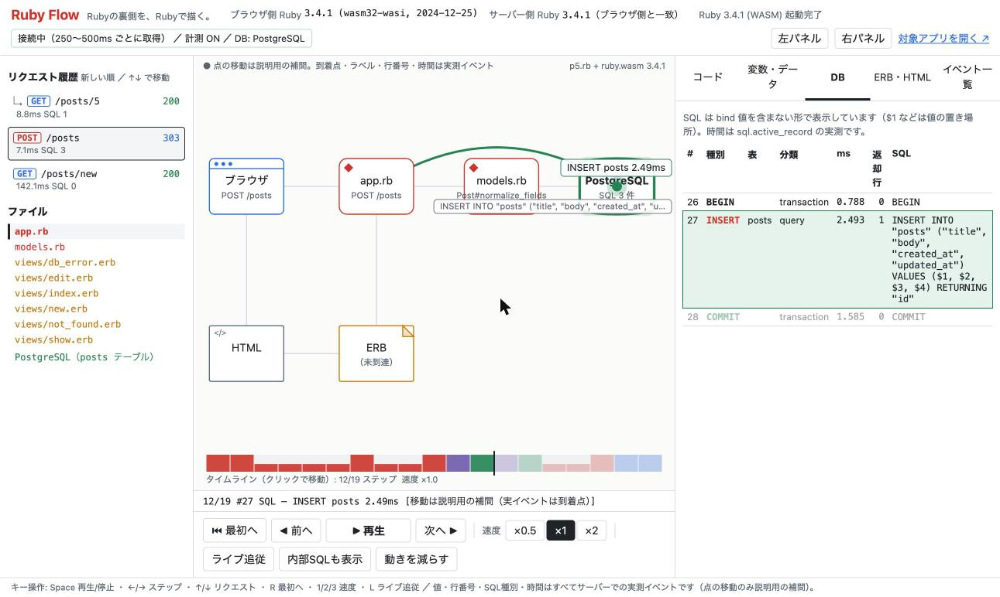

# Ruby Flow — Rubyの裏側を、Rubyで描く。

Sinatra / ActiveRecord / PostgreSQL / ERB で書かれた投稿アプリを実際に操作すると、
**ブラウザ → HTTP → app.rb → models.rb → PostgreSQL → ERB → HTML** の流れを、
サーバーで実測したイベントから **p5.rb（ブラウザ上の Ruby / ruby.wasm）** で描きます。
教育者・初学者向けの MVP です（P0〜P5）。

- 値・行番号・SQL 種別・時間はすべてサーバーでの実測イベントです。点の移動アニメーションだけが説明用の補間です。
- パスワード・Cookie・認証情報・SQL の bind 値は収集しません。値を表示するのは許可したデモ項目（title / body など）だけです。
- ローカル（127.0.0.1）専用です。



## 必要なもの
- Ruby **3.4.1**（`.ruby-version`）、Bundler
- PostgreSQL（ローカル）
- ブラウザ（Chrome で確認済み）。WebAssembly が動くこと

## セットアップ
```sh
ruby -v            # ruby 3.4.1
bundle install
```

### データベースの準備（重要）
`config/database.yml`（原本）は **変更しません**。
このリポジトリでの検証時、原本の設定が指す DB はサーバー上に未作成でした（`NoDatabaseError`）。次のどちらかで準備します。

**A. 専用DBを使う（推奨・検証で使用した方法）** — `DATABASE_URL` で明示します。
```sh
createdb -h 127.0.0.1 ruby_flow_dev     # ブラウザで動かす用
createdb -h 127.0.0.1 ruby_flow_test    # テスト用（名前は *_test 必須）
DATABASE_URL=postgres://127.0.0.1/ruby_flow_dev  bundle exec rake flow:migrate
DATABASE_URL=postgres://127.0.0.1/ruby_flow_test bundle exec rake flow:migrate
```
`rake flow:migrate` は、DB 名が `ruby_flow_*`・ホストがローカル・実際の接続先 DB 名とアダプタ（PostgreSQL）が一致することを確かめてから `db:migrate` します。
`bundle exec rake flow:verify_db` で接続先だけ確認できます（接続情報は表示しません）。

**B. 設定ファイルの DB を使う** — `bundle exec rake db:create db:migrate`（2026-11-25 に利用者の指示で実行済み）。
この場合は `DATABASE_URL` なしで起動できます: `bundle exec ruby app.rb -o 127.0.0.1 -p 9292`

## 起動
```sh
DATABASE_URL=postgres://127.0.0.1/ruby_flow_dev bundle exec ruby app.rb -o 127.0.0.1 -p 9292
```
- 対象アプリ: http://127.0.0.1:9292/
- Ruby Flow（可視化）: http://127.0.0.1:9292/visualizer/index.html （`/__flow` でも可）

2 つを別タブで開き、アプリ側で投稿の作成・編集・削除をすると、可視化側に流れが表示されます（ライブ追従）。
計測を止めるには `RUBY_FLOW=off` を付けて起動します（比較用）。

### 画面の見方
- 中央（p5.rb）: ブラウザ（青）/ app.rb・models.rb（赤）/ PostgreSQL（緑）/ ERB（琥珀）/ HTML。実行中のノードが強調され、データ（ラベル付きの点）が移動します。下部はタイムライン（クリックで移動）。
- 左: リクエスト履歴（POST の後のリダイレクト先 GET は ↳ で関連表示）とファイル。
- 右タブ: コード（実行行ハイライト）/ 変数・データ（実行直前の値、title・body の変遷）/ DB（bind 値なしの SQL・実測時間・確定行）/ ERB・HTML（ERB に渡したデータ、式 → エスケープ後 HTML）/ イベント一覧。
- 操作: Space 再生/停止、←/→ ステップ、↑/↓ リクエスト、R 最初へ、1/2/3 速度（×0.5/×1/×2）、L ライブ追従。「動きを減らす」で移動アニメーションを省略。

## テスト
```sh
DATABASE_URL=postgres://127.0.0.1/ruby_flow_test bundle exec rake test
```
`DATABASE_URL` が `ruby_flow_*_test` 以外、または実際の接続先が一致しない場合は実行前に中止します（原本設定へフォールバックしません）。
テストでは専用テストDBの posts だけを空にします。

性能比較（計測あり/なし）:
```sh
DATABASE_URL=postgres://127.0.0.1/ruby_flow_test bundle exec ruby script/benchmark.rb 200
```

## 構成
| 場所 | 役割 |
|---|---|
| `app.rb` / `models.rb` / `views/*.erb` | 原本を土台にしたデモ CRUD（原本の行は残し追記） |
| `lib/ruby_flow/` | 計測（Rack ミドルウェア、対象限定 TracePoint、SQL 購読、ERB 境界、EventStore、API、DB ガード） |
| `public/visualizer/ruby/` | 可視化（p5.rb で動く Ruby：イベント解釈・再生・描画・パネル） |
| `public/visualizer/boot.js` | ruby.wasm 起動・fetch・DOM イベント転送のみ |
| `public/visualizer/vendor/` | ruby.wasm 3.4.1 / p5.js 1.5.0 / p5.rb（ローカル固定。`docs/DEPENDENCIES.md`） |
| `docs/STATUS.md` | 進捗・テスト結果・未達項目 |
| `docs/screenshots/` | 実ブラウザでのスクリーンショット |

## 既知の制約
`docs/STATUS.md` の「未達・制約・残課題」を参照してください。
